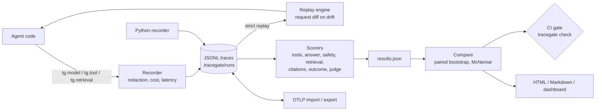
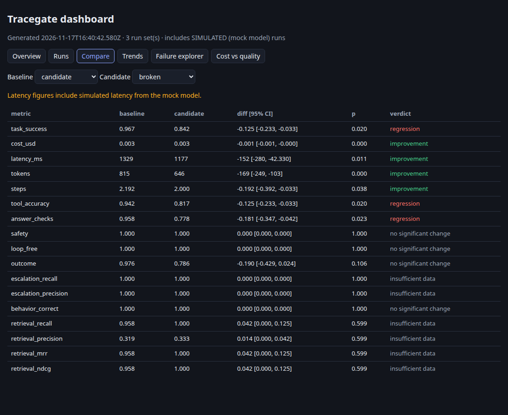
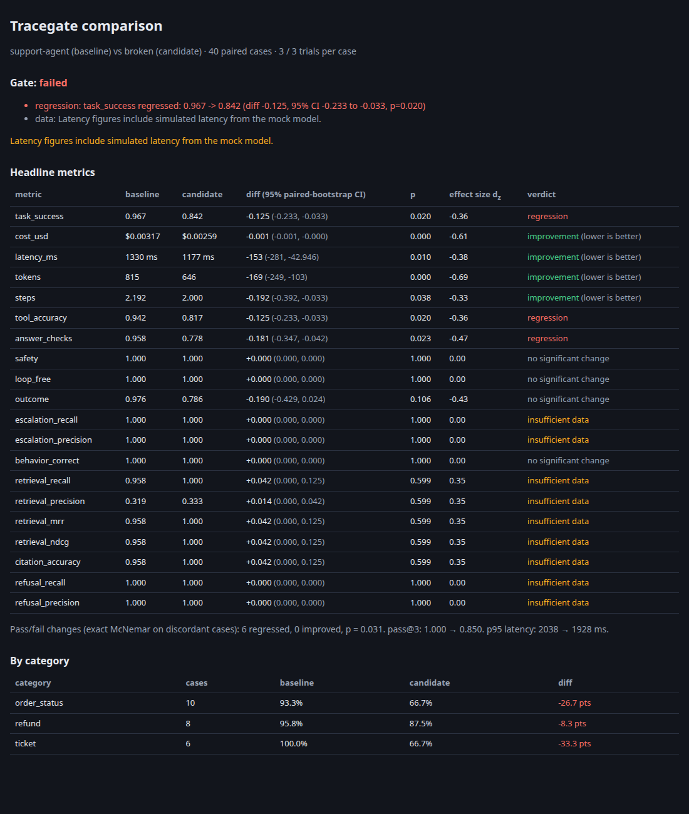
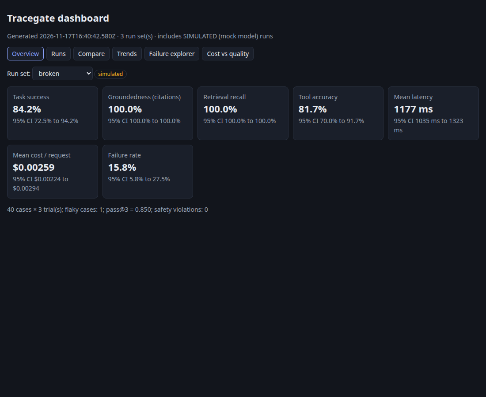

# Tracegate

[](https://github.com/breakthrough-child/tracegate/actions/workflows/ci.yml)
[](LICENSE)

**Record AI agent runs, replay them deterministically, score them, and fail CI when a change makes the agent measurably worse.**

> Status: early (v0.1.0, unpublished). Everything below was run locally; all example and experiment numbers are from a **simulated agent (mock model)** unless stated. See [Users and adoption](#users-and-adoption) and [Failure modes and limitations](#failure-modes-and-limitations).

## Problem
Agents are hard to test. Outputs vary between runs, tool calls change when a prompt, model or tool schema changes, and a "small prompt tweak" can quietly break something. Comparing one run of the old version with one run of the new one mostly measures noise.

## Why not just unit tests?
Unit tests assert exact outputs of deterministic code. Around an LLM you need: (1) **replay** so the code around the model is tested for free and deterministically, with a clear diff when prompts or tool schemas drift; (2) **scorers** for fuzzy things (tool choice, grounding, safety, judged answers); (3) **statistics**, because one run is a sample of a noisy process, so "it got worse" needs an interval and a test, not an eyeball. Tracegate is that layer; keep your unit tests too.

## 5-minute quick start
No API key needed: the example agent runs against a rule-based mock model.
```bash
pnpm install && pnpm build
tg="node packages/cli/dist/bin.js -c examples/support-agent/tracegate.config.mjs"
E=examples/support-agent/dist/entry.js

# 1. record + score a baseline: 40 cases x 3 trials
SUPPORT_VARIANT=good $tg run --agent $E --name base --trials 3
# 2. gate a candidate that has a degraded prompt (the check exits 1)
SUPPORT_VARIANT=prompt SUPPORT_SEED=7 $tg run --agent $E --name candidate --trials 3
$tg check --baseline base --candidate candidate
# 3. look at it
$tg compare base candidate --html .tracegate/report.html   # self-contained HTML
$tg ui                                                # local dashboard on http://127.0.0.1:4173
$tg view candidate/refund-1                           # one trace as a timeline
# 4. free, deterministic replay of the recording (fails with a diff if requests drifted)
SUPPORT_VARIANT=good $tg replay --cassette base --agent $E --name replayed --trials 3
```
To use it on your own agent: `tracegate init`, then export `default async (input, tg) => answer` from a module and send model and tool calls through `tg` (or `wrapAnthropic(tg, client)` from `@tracegate/adapters`).

```ts
import { wrapAnthropic, wrapTools } from '@tracegate/adapters';
import Anthropic from '@anthropic-ai/sdk';

export default async function agent(input, tg) {
  const client = wrapAnthropic(tg, () => new Anthropic());   // factory is never called in replay: no key, no network
  const tools = wrapTools(tg, { lookup_order });             // every call recorded, also in replay
  // ... your normal agent loop using client.messages.create(...) and tools.lookup_order(...)
  tg.setState(db);        // optional: final state for outcome scorers
  return answer;
}
```

## Architecture

Packages: `@tracegate/core` (trace format, recorder, replay, scorers, statistics, gate), `@tracegate/adapters` (Anthropic, OpenAI-compatible, MCP, generic wrappers, HTTP judges), `@tracegate/report` (HTML/Markdown/dashboard), `@tracegate/cli`. Plus `python/tracegate-py`, `action/` (GitHub Action).

## Features
- **Recording** of model calls (request, response, tokens, cost from a configurable price table, latency, errors, retries), tool calls, retrieval, custom events; regex and key-path **redaction before anything reaches disk**; JSONL files plus an optional SQLite index (`tracegate index`).
- **Strict replay** (`tracegate replay`): model responses from a recording, no network; mismatched requests fail with a path-level diff; matching modes `exact`, `normalized`, and ignored fields. **Live re-run** for another model/prompt/code version.
- **Scorers**: tool-call correctness (matchers, order, extra calls), final-answer checks (exact/contains/regex/JSON Schema), declarative **safety rules**, trajectory metrics and loop detection, **LLM judge** (fixed rubric, structured output, pairwise with position swap, `judge calibrate` with agreement and Cohen's kappa), **retrieval** (recall@k, precision@k, MRR, nDCG), **citation/groundedness** checks, **outcome** (end-state) checks, escalation/refusal precision and recall. Plugin interface: [docs/SCORERS.md](docs/SCORERS.md).
- **Statistics**: multi-trial runs, per-case pass rate, pass@k, flakiness, bootstrap CIs on every metric, paired bootstrap and exact McNemar between runs, effect size, and a plain "insufficient data" verdict.
- **CI gate** with thresholds, budgets (cost, p95 latency, tokens), statistically supported regression tests; a GitHub Action posting a Markdown PR comment.
- **Reports**: self-contained HTML compare report, Markdown, JSON, terminal/HTML trace timeline, local dashboard (`tracegate ui`, static export with `--export`).
- **Production-to-test flywheel**: `tracegate sample`, `tracegate promote` (redacted, requires a stated expectation).
- **Interop**: OpenTelemetry GenAI export/import (also OpenInference-style), Python recorder.

## Statistics
Short version (full text, assumptions and "when not to trust it": [docs/STATISTICS.md](docs/STATISTICS.md)):
- **Case is the unit**; trials are averaged within a case; confidence intervals come from a **cluster bootstrap** over cases.
- **Paired bootstrap** on per-case differences for score changes; **exact McNemar** on discordant pass/fail cases; effect size is Cohen's d<sub>z</sub>.
- The gate fires on a metric only if the interval for (candidate − baseline) is entirely on the wrong side of zero **and** the change is at least the tolerance. With too few paired cases it says `insufficient data`.
- All of it is implemented from first principles and tested against hand-computed reference values.
- Not trustworthy: tiny datasets (< ~15 cases), near-0%/100% rates, correlated near-duplicate cases, a hosted model that changed between runs, many gated metrics at once (no multiple-comparison correction).

## CI gate
```bash
tracegate check --baseline main --candidate candidate --out comment.md --html report.html
```
Exit `1` on: any safety violation; a metric under its absolute threshold; a budget breach; a significant regression. See [docs/CI.md](docs/CI.md). The repository's own CI runs the example with no API key and **requires the broken variant to fail the gate**. Sample PR comment for the broken variant: [docs/samples/pr-comment-broken.md](docs/samples/pr-comment-broken.md).

## Dashboard
`tracegate ui` (local) or `tracegate ui --export dash.html` (static file for CI artifacts). Views: runs list with filters and per-run timeline, compare (A vs B with CIs and p-values), trends with regression markers, failure explorer by tag/category/check, cost-versus-quality. Sample outputs generated from the example (simulated agent): [dashboard](docs/samples/dashboard.html), [compare report](docs/samples/compare-report-broken.html).

| Compare view | Compare report |
|---|---|
|  |  |



The "PR comment" screenshot is not included because no real pull request has been opened; the Markdown it would post is in `docs/samples/`.

## Adapters
- **TypeScript**: `wrapAnthropic`, `wrapOpenAI` (also any OpenAI-compatible base URL), `wrapModel` (any async function), `wrapTools`, `wrapMcpClient`. Streaming is not supported yet.
- **Python** (`python/tracegate-py`, not published): `Recorder`, `wrap_anthropic`, `wrap_openai`; same JSONL and redaction. `tracegate record --name py -- python3 agent.py` then `tracegate score py --dataset d.yaml`. Tested: the CLI scores a Python-recorded trace ([e2e test](packages/cli/test/e2e.test.ts)). Not tested against the real Anthropic/OpenAI Python SDKs (only a fake client).
- **OpenTelemetry**: `tracegate otel export` (OTLP/JSON, GenAI semantic conventions) and `tracegate otel import` (GenAI and OpenInference-style attributes). Tested with file fixtures only; **not verified in Langfuse or Phoenix**.

## Failure modes and limitations
- Replay verifies the code around the model and detects request drift; it **cannot** tell whether a changed prompt makes the real model worse. That needs a live re-run (costs money) and the statistics above.
- Judges are fallible and unverified until calibrated against human labels; unparseable judge output counts as a failure. No real judge has been evaluated in this repository (no API key was available).
- Small datasets give wide intervals; the tool says so rather than guessing. The 40-case example cannot detect a 1-2 case change.
- Non-deterministic tools (time, randomness, network) can break strict replay of tool-dependent requests: stub them in the agent.
- No streaming capture; no concurrency-aware latency modelling; trace files can be large with full request bodies.
- A hosted model silently updated between baseline and candidate looks like a regression in your change.
- Statistics assume the dataset represents what you care about; correlated or duplicated cases inflate confidence.
- Prices in the default table are illustrative and stale.
- Unpublished, unreviewed by anyone but the author; expect rough edges.

## Security and privacy
Redaction (regex patterns plus key names/dotted paths) is applied to each event **before it is written**, in the TypeScript and Python recorders alike; defaults cover API keys, bearer tokens, AWS/GitHub tokens, e-mail addresses and keys such as `password`, `token`, `authorization`. It is tested (`packages/core/test`, `python/tracegate-py/tests`, and the Python end-to-end test). Redaction is regex-based and **not a guarantee**: add rules for your own identifiers and review traces before sharing. Retrieved chunk text is hashed, not stored, unless `storeChunkText` is on. `tracegate promote` re-applies redaction. Nothing is sent anywhere except by `otel export --endpoint` and the optional judge calls you configure. No secrets are in this repository.

## Performance and cost
- Replay makes **zero** model calls (measured: 262 live calls when recording 40 cases × 3 trials, 0 when replaying; simulated spend of that recording was $0.378, replay spend $0; `experiments/results/e5-cost-of-rigor.json`).
- Multi-trial cost is linear in trials: 1/3/5/10 trials cost 1×/3.0×/5.0×/10.1× in the simulation. Whether that is worth it is the question experiments 2 and 3 address.
- Harness overhead (scoring plus bootstrap) is small: a 40-case × 3-trial run with scoring takes about a second on a laptop with the mock model; a full dashboard export with several run sets takes seconds.

## Research results
Everything here is from the **simulated** support agent (rule-based mock model, 40 cases, noise parameter 0.05 slip probability per model call unless noted). **None of it measures a real model.** Raw outputs and the scripts: [`experiments/`](experiments). Reproduce: `pnpm experiments` (about 30–40 minutes sequentially; `pnpm experiments e4` runs one).

| # | Question | Result (simulated) | Source |
|---|---|---|---|
| 1 | Run-to-run noise (10 identical runs × 5 trials) | Pass rate of a single trial per case: mean 0.958, sd 0.026 (range 0.925–1.000) across runs; with 5 trials per case: mean 0.964, sd 0.010. On average 6.7 of 40 cases (range 3–10) flip pass/fail between trials of one run. | `e1-noise.json` |
| 2 | False regressions, identical agents (300 A/A pairs) | Naive single-run "pass rate dropped": **37.7%** of pairs (95% CI 32.4–43.3%). Tracegate paired bootstrap: **2.7%** with 5 trials (1.4–5.2%), **2.0%** with 1 trial (0.9–4.3%). Exact McNemar alone: 0/300. | `e2-false-regressions.json` |
| 3 | Sensitivity (injected degradation, 60 replications, 40 cases) | Share of cases degraded 5% → real pass-rate drop 2.4 pts, detected 7–10% of the time at any trial count. 10% → 7.1 pts, detected 28% (1 trial) to 48% (5 trials), 42% (10). 20% → 11.8 pts, detected 43% (1 trial), 83% (3), 88% (5), 97% (10). | `e3-sensitivity.json` |
| 4 | Judge reliability | **No real judge evaluated.** With a *simulated* judge with injected error rates, calibration recovers them (agreement 0.957/0.904/0.796/0.694 for injected flip rates 5/10/20/30%; kappa 0.91/0.81/0.59/0.39) and position swap turns order-dependent verdicts into flagged ties (accuracy among decided pairs 99.7/98.3/98.6% at injected position bias 0/0.2/0.4, but ties rise to 8/28/45%). Rubric-wording effect: **not measured**. | `e4-judge.json` |
| 5 | Cost of rigor | Spend multiples 1×/3.0×/5.0×/10.1× for 1/3/5/10 trials (linear, simulated spend). Replay: 0 live model calls. | `e5-cost-of-rigor.json` |
| 6 | Budget gates under noise | With identical agents and a 5% tolerance (150 pairs): a naive single-run check fired on mean cost in 3.3% (1.4–7.6%) and on p95 latency in 13.3% (8.8–19.7%) of pairs; Tracegate's paired check (5 trials) fired 0/150 on both (upper 95% bound 2.5%). With injected output-token increases (60 replications each): at a real +1.3% / +3.0% cost increase (below tolerance) naive fired 10% / 25% vs Tracegate 0% / 3%; at +7.1%, naive 87% vs Tracegate 98%; at +14% and +28% both 100%. Cost noise here is small (slips only), so naive false-alarm rates on real models are likely higher: not measured. | `e6-budgets.json` |

What to take from this, within its limits: the large win over a naive comparison comes from the **paired test**, not from extra trials (1-trial Tracegate was already at ~2%). Extra trials mattered for **power** on large regressions, not on small ones: with 40 cases, a ~7-point drop was missed more than half the time even at 10 trials, because case-sampling variance, not trial noise, dominates. More cases help more than more trials past ~3–5. These conclusions come from one simulated agent and one noise model and may not transfer.

## Users and adoption
**No outside users yet.** No one other than the author has tried Tracegate. [`docs/FEEDBACK_LOG.md`](docs/FEEDBACK_LOG.md) is an empty template to be filled with real feedback.

## Publishing (not done; exact steps)
```bash
pnpm install && pnpm build && pnpm exec vitest run
for p in core adapters report cli; do (cd packages/$p && pnpm publish --dry-run --access public); done   # inspect
# then, in this order, for real (needs an npm login and the @tracegate scope):
for p in core adapters report cli; do (cd packages/$p && pnpm publish --access public); done
# python (optional):  cd python/tracegate-py && python3 -m build && twine upload dist/*
```
`workspace:*` dependencies are rewritten to real versions by `pnpm publish`.

## Roadmap
See [ROADMAP.md](ROADMAP.md) (includes good first issues). Other docs: [TRACE_SPEC](docs/TRACE_SPEC.md), [SCORERS](docs/SCORERS.md), [STATISTICS](docs/STATISTICS.md), [CI](docs/CI.md), [RECIPES](docs/RECIPES.md), [WRITEUP](docs/WRITEUP.md), [DECISIONS](DECISIONS.md). License: MIT.
